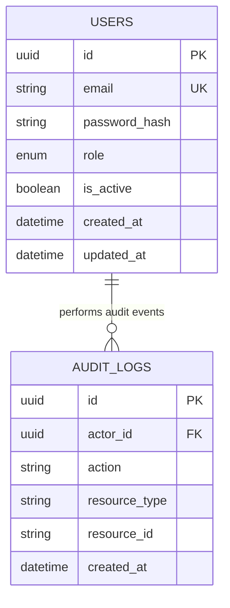

# MediLink — Clinical Healthcare & Hospital Operations Platform

[](https://python.org)
[](https://fastapi.tiangolo.com)
[](https://react.dev)
[](https://typescriptlang.org)
[](https://vitejs.dev)
[](https://sqlalchemy.org)
[](https://passlib.readthedocs.io)
[](https://pytest.org)

**MediLink** is a modern, enterprise-ready hospital operations and clinical workspace platform. Built with a **FastAPI** backend, **SQLAlchemy 2.0** ORM, and a **React 18 + TypeScript + Vite** frontend, MediLink streamlines patient intake, emergency triage, clinical consultations, e-prescriptions, diagnostic laboratories, medical inventory, and role-based staff provisioning.

---

## Architecture Overview

```text
┌───────────────────────────────────────────────────────────┐
│              React 18 + TypeScript Web Client             │
│   (Vite SPA · Plus Jakarta Sans UI · Strict Types · CSS)  │
└─────────────────────────────┬─────────────────────────────┘
                              │
                              │ SameSite=Strict, HttpOnly Session Cookie
                              ▼
┌───────────────────────────────────────────────────────────┐
│                    FastAPI REST Backend                   │
│   • Argon2id Password Ciphers (Passlib)                   │
│   • Role-Based Access Control (RBAC) Dependencies         │
│   • Tamper-Evident Audit Event Logger                     │
│   • Pydantic v2 Schema Validation                         │
└─────────────────────────────┬─────────────────────────────┘
                              │
                              │ SQLAlchemy 2.0 Engine & Alembic Migrations
                              ▼
┌───────────────────────────────────────────────────────────┐
│               Relational Database Layer                   │
│       PostgreSQL 16 (Production) / SQLite (Dev)           │
└───────────────────────────────────────────────────────────┘
```

### Relational Schema



---

## Core Clinical & Operational Modules

| Module | Features & Capabilities |
| :--- | :--- |
| **Operations Command Center** | Real-time KPI telemetry (admissions, triage queue, bed utilization), donut triage queue monitor, today's clinical consultations schedule, bed occupancy by ward, and quick workflow shortcuts. |
| **Patients Registry** | Multi-attribute patient search and filtering by medical department, triage priority, and care status. Includes a deep-dive patient detail drawer (vital signs gauge, allergies, attending physician, and care actions). |
| **Patient Admission (Intake)** | Comprehensive admission intake modal capturing full demographics, blood group, emergency contact, attending clinician, triage priority (Routine, Urgent, Emergency), initial vital signs, and known allergies. |
| **Triage & Queue Monitor** | Live outpatient queue monitor with queue position badges, triage priority classification, vital signs telemetry, and one-click "Call into Consultation" workflow. |
| **Clinic Appointments** | Outpatient schedule manager with room assignments, physician filters, appointment types (Consultation, Routine Checkup, Specialist Review, Emergency), and status workflow (`Confirmed` → `Waiting` → `In Progress` → `Completed`). |
| **Dispensary & Pharmacy** | Electronic prescription tracker, dosage protocols, allergy contraindication checks, and dispensing sign-off. |
| **Diagnostic Laboratory** | Specimen orders for Hematology, Biochemistry, Radiology, and Microbiology, turnaround times, diagnostic findings preview, and normal/abnormal/critical result flags. |
| **Medical Inventory** | Central supply depot catalogue, stock level progress gauges, reorder threshold alerts (`In Stock`, `Low Stock`, `Critical`), and one-click restocking. |
| **Staff & RBAC Management** | Staff directory integrated directly with FastAPI backend `/api/v1/users`, supporting 7 system roles (`administrator`, `doctor`, `nurse`, `receptionist`, `pharmacist`, `laboratory`, `accountant`). |
| **Facility Analytics** | Department workload breakdown bars, hourly patient intake curve, patient satisfaction scores (4.8/5.0), and clinical quality benchmarks. |
| **Settings & API Telemetry** | Medical center profile configuration, live backend `/health` ping with round-trip latency counter (in milliseconds), and cryptographic policy overview. |

---

## Default Development Credentials

For quick local testing and evaluation, the following pre-configured credentials are ready to use:

| Role | Email | Password | Privileges |
| :--- | :--- | :--- | :--- |
| **Administrator** | `admin@example.com` | `admin-secure-password-12345` | Full system access, staff account provisioning, and audit logs |
| **Doctor** | `doctor@example.com` | `test-doctor-password-123` | Clinical consults, patient records, and medical reviews |
| **Nurse** | `nurse.elena@medilink.org` | *(One-click demo switch)* | Vitals recording, triage assessment, and ward care |
| **Receptionist** | `reception@medilink.org` | *(One-click demo switch)* | Patient intake, check-in queue, and appointment booking |
| **Pharmacist** | `pharmacy@medilink.org` | *(One-click demo switch)* | Prescription dispensing and supply level verification |

---

## Quick Start Guide

### Option 1: One-Click Development Launch (Windows)

From the project root:

```powershell
# Run using PowerShell
powershell -ExecutionPolicy Bypass -File .\start-dev.ps1

# Or run via Batch
.\start-dev.bat
```

This runs migrations, bootstraps the administrator account, starts the FastAPI server on `http://localhost:8000`, and opens the Vite React client on `http://localhost:5173`.

---

### Option 2: Manual Local Startup

#### 1. Backend Setup (FastAPI)

```powershell
# From the repository root
python -m pip install -e ".[dev]"

# Run database migrations and bootstrap administrator
cd backend
alembic upgrade head
python -m app.bootstrap_admin

# Start FastAPI dev server
uvicorn app.main:app --reload --port 8000
```

- API Docs (Swagger UI): **`http://localhost:8000/docs`**
- Health Probe: **`http://localhost:8000/health`**

#### 2. Frontend Setup (React + Vite)

```powershell
# In a new terminal, from the frontend directory
cd frontend
npm install
npm run dev
```

- Web Application: **`http://localhost:5173`**

---

### Option 3: Docker Compose (PostgreSQL + API)

```powershell
# Copy environment configuration
Copy-Item .env.example .env

# Build and start PostgreSQL and API containers
docker compose up --build -d

# Run database migrations and bootstrap administrator
docker compose exec api alembic upgrade head
docker compose exec api python -m app.bootstrap_admin
```

---

## API Surface

| Method | Endpoint | Description | Role Required |
| :--- | :--- | :--- | :--- |
| `GET` | `/health` | Database readiness and liveness probe | Public |
| `POST` | `/api/v1/auth/login` | Authenticate credentials and issue HttpOnly session cookie | Public |
| `POST` | `/api/v1/auth/logout` | Clear authenticated session cookie | Authenticated |
| `GET` | `/api/v1/auth/me` | Fetch active authenticated user profile | Authenticated |
| `GET` | `/api/v1/dashboard` | Role-aware status and available modules | Authenticated |
| `GET` | `/api/v1/users` | List all provisioned staff accounts | `administrator` |
| `POST` | `/api/v1/users` | Provision a new staff account with Argon2id hash | `administrator` |

---

## Project Structure

```text
caps/
├── backend/
│   ├── alembic/              # Database migration versions and environment
│   │   └── versions/         # Foundation schema revision
│   ├── app/
│   │   ├── api/              # REST routers: auth, users, dashboard, dependencies
│   │   ├── core/             # Configuration settings and security/crypto helpers
│   │   ├── db/               # SQLAlchemy engine and session factory
│   │   ├── models/           # Persisted database models: User, AuditLog
│   │   ├── schemas/          # Pydantic v2 validation models
│   │   ├── bootstrap_admin.py# Idempotent administrator provisioning CLI
│   │   └── main.py           # FastAPI application factory and CORS middleware
│   ├── tests/                # Automated pytest suite (conftest, test_auth)
│   └── alembic.ini           # Alembic migration configuration
├── frontend/
│   ├── src/
│   │   ├── api/              # Typed backend REST client and health ping
│   │   ├── components/       # UI Components: Header, Sidebar, Icons
│   │   │   └── Modals/       # RegisterPatient, BookAppointment, Auth, PatientDetails
│   │   ├── data/             # Rich initial clinical seed data
│   │   ├── pages/            # Overview, Patients, Queue, Appointments, Rx, Labs, Inventory
│   │   ├── types/            # TypeScript interfaces for healthcare models
│   │   ├── App.tsx           # Primary application controller and state orchestrator
│   │   ├── main.tsx          # Application entrypoint
│   │   └── styles.css        # Clean, modern healthcare design system CSS
│   ├── index.html            # HTML template with Google Fonts (Inter & Plus Jakarta Sans)
│   ├── vite.config.ts        # Vite configuration with API reverse proxy
│   └── tsconfig.json         # Strict TypeScript compiler options
├── compose.yaml              # Docker Compose definition (PostgreSQL + API)
├── Dockerfile                # Multi-stage production container build
├── pyproject.toml            # Backend dependencies and packaging definition
├── start-dev.ps1             # Windows PowerShell one-click development runner
├── start-dev.bat             # Windows Batch development runner
├── .editorconfig             # Universal code formatting standards
├── .gitignore                # Comprehensive Git ignore rules
└── README.md                 # Project documentation
```

---

## Testing & Quality Verification

Run backend test suite with Pytest:

```powershell
pytest
```

Run frontend build and TypeScript verification:

```powershell
cd frontend
npm run build
```

---

## Security & Clinical Notice

> [!IMPORTANT]
> This platform implements secure authentication, server-enforced role boundaries, and audit logging. In development mode, mock clinical entries are stored in session memory and temporary database files. Do not enter real Protected Health Information (PHI) or patient records into a development build. Production deployments require TLS termination (`COOKIE_SECURE=true`), external tamper-proof log storage, and institutional clinical safety approvals.
